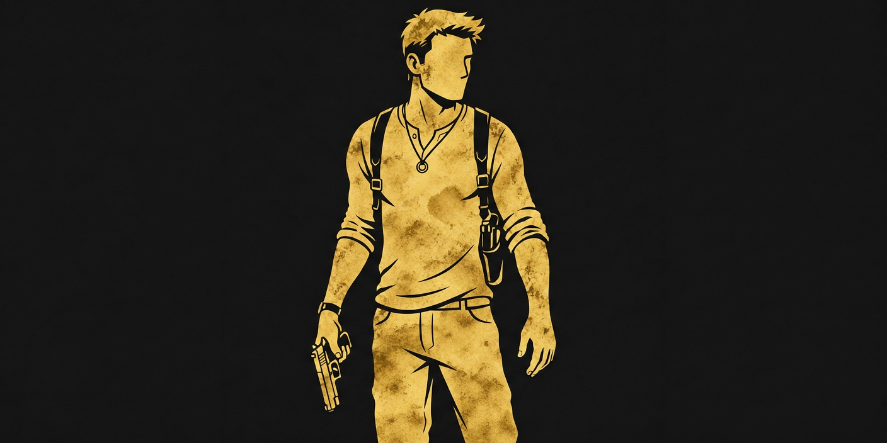

  <a href="https://recomplauncher.com/game/uncharted-the-nathan-drake-collection-pc-port-2">
    <picture>
      <source media="(prefers-color-scheme: dark)" srcset="https://recomplauncher.com/assets/press/launcher/badge-dark.svg">
      
    </picture>
  </a>

  
  &nbsp;
  

A free, non-commercial fan project that runs the PS4 *Uncharted: The Nathan Drake Collection* natively on Windows, using your own copy. Includes *Drake's Fortune*, *Among Thieves* and *Drake's Deception*, plus an experimental **Uncharted 2 & Uncharted 3 multiplayer restoration**.

The games' x86-64 code runs directly on your PC, with a runtime for PS4 system libraries and a Vulkan renderer. This fork adds a C++ launcher based on the original launcher.

> **No game files included. Legally obtained copies required.** Not affiliated with or endorsed by Sony Interactive Entertainment, Naughty Dog or Bluepoint Games.

## Status

- **Singleplayer:** All three games play, with working menus, game switching, saves, audio, cutscenes and controllers. Uncharted 2 and 3 have been played at up to 4K and above 60 FPS on fast GPUs; Uncharted 3 has had less testing.
[Releases](../../releases)
- **Multiplayer:** Still in testing, but you can try it out already! See the [**progress**](/assets/DEVELOPMENT_PLAN.md) for our long-term development plan! You can also join our [**Discord server**](https://discord.com/invite/T545xWcpSw) to play with the community or report any issues!

## Requirements

- **OS:** Windows 10 or 11, 64-bit.
- **RAM:** About 6 GB free; 16 GB installed recommended.
- **CPU:** Intel Core 4th generation (Haswell) or newer, or any AMD Ryzen.
- **CPU features:** AVX, F16C, BMI1, MOVBE and LZCNT.
- **Graphics:** NVIDIA, AMD or Intel GPU with Vulkan 1.3 and current drivers.
- **Game:** Your own dumped PS4 Collection; update **1.02** recommended.

Four CPU cores can hold 60 FPS in Drake's Fortune and Uncharted 3. On Ryzen 7000/9000 integrated Radeon graphics, use **Low**: tested performance is 24–39 FPS at 720p.

## Install and update

1. Download **UCMR_windows.zip** from [Releases](../../releases/latest/download/UCMR_windows.zip) and extract it.
2. Open **UCMR_Launcher.exe** and select your dumped `CUSA02344` folder containing `eboot.bin` and `sce_sys`.
3. Add update **1.02** through **SETUP → step 2**, or place it beside the game as `CUSA02344-patch`.
4. Choose a game and preset, then press **PLAY**. First launch compiles shaders, so loading and stutter are expected.

- **In-game menu:** `Insert` or `R3 + L2`.
- **Settings:** Saved separately for each game.
- **Saves and logs:** In `analysis` beside the launcher.
- **Updates:** Use **UPDATE TO x.y.z** in the launcher. It checks SHA-256, preserves saves, settings and shader caches, and rolls back if an update fails.
- **RecompLauncher:** Installed through [RecompLauncher](https://recomplauncher.com/game/uncharted-the-nathan-drake-collection-pc-port-2), UCMR is updated there instead ([details](docs/RECOMPLAUNCHER.md)).

See [Controls and PC setup](tools/README-Windows.txt) for more help.

## Uncharted 2 & Uncharted 3 multiplayer (beta)

Competitive, co-op and LAN party modes are restored through the **MULTIPLAYER** tab. Import requires your own copies and:

- **PS4 Collection 1.02:** CUSA02320 (EU) or CUSA02343 (US); their 1.02 executables are byte-identical.
- **PS3 Uncharted 3 GOTY:** BCES01670, BCES01692, BCUS99086 or BCAS25014.
- **PS3 data:** The game folder and RPCS3's `dev_hdd0/game` folder with Uncharted 2 GOTY update **1.10** and Uncharted 3 GOTY update **1.19**, the game data install and DLC map packs.
- **Executable:** Your Uncharted 2 decrypted 1.10 `EBOOT.elf` and Uncharted 3 decrypted 1.19 `EBOOT.elf`.
- **Storage:** About **14 GB free**.

Press **IMPORT** and follow the progress log.  Conversion takes approximately 12 minutes, depending on the type of drive (SSD or HDD), and resumes if the launcher is closed. Map and character conversions are still being completed; failed steps appear in the log.

## Legal status

- **No game content distributed:** The repository and releases contain no game files, game code or game-derived data. The launcher and importer download none; they use local files only.
- **Your copies, local processing:** You need legally obtained PS4 and, for multiplayer, PS3 copies. Converted files and patched game images are made on your PC and never shared by the project.
- **No piracy or decryption:** The project does not obtain games, decrypt them or help bypass protection on games you do not own. It uses your own dumps and rejects encrypted store PKGs.
- **Restoration code:** Multiplayer code was written from scratch to reproduce PS3 behaviour. Apart from short instruction patterns used to locate and verify patches, it contains no code from either game.
- **No bundled game keys or secrets:** Online-profile values are read locally from your own decrypted PS3 executable and placed only in your locally built game image. They never leave your PC.
- **Online service:** Community RPCN servers, with no connection to PlayStation Network, which no longer hosts these games' multiplayer.
- **No affiliation:** Not endorsed or supported by Sony Interactive Entertainment, Naughty Dog, Bluepoint Games or their affiliates. *Uncharted* belongs to Sony Interactive Entertainment LLC; PlayStation, PS3, PS4 and PlayStation logos are trademarks of Sony Interactive Entertainment Inc. Game content and other trademarks belong to their owners and are used only for identification.
- **Free and open source:** No donations, sales or ads. GPL v2 or later source is included for everything covered by that license. Provided “as is”, without warranty. See the license details below for separate packaged components.
- **Rights holders:** [Open an issue](../../issues) with any concern; it will be reviewed promptly.

## Contributing

A small number of regular contributors are welcome through fork-based pull requests.

**In scope:** Game-breaking glitches (crashes, freezes, soft-locks, broken audio or controls) and visual issues (colours, textures, geometry, effects or HUD).

**Out of scope:**

- Online play, RPCN and matchmaking, which are maintained privately.
- Build and release setup: `.github/workflows/`, `tools/release.sh`, `tools/VERSION`, launcher self-updates and `u3mp/patcher/maintainer/`.
- Game files in any form. Fixes must be code or recipes that run on the player's PC.

Comment on an issue and wait for a reply before starting. Submit one small fix per branch, rebased on `main`, with the problem, reproduction steps, changes and test results. The maintainer reviews, tests and merges. Follow [CONTRIBUTING.md](CONTRIBUTING.md); all pull requests are GPL v2 or later.

## Credits and license

- [**João Fidalgo**](https://github.com/fidalgojoao): launcher, Uncharted 2 and 3 multiplayer restoration, pak tools.
- [**Tha14**](https://github.com/Tha14): launcher, Uncharted 2 and 3 multiplayer.
- [**33martyr**](https://github.com/33martyr): Uncharted 3 multiplayer map and character visual fixes.
- [**BilalReloaded**](https://github.com/bc160201983): the [original PC port](https://github.com/bc160201983/Uncharted-The-Nathan-Drake-Collection-PC-port), whose PC runtime (`gow3_pc`) this project started from.
- **Runtime base:** [gow3_pc](https://github.com/FelipePrado0/gow3_pc) and the [shadPS4](https://github.com/shadps4-emu/shadPS4) video core.
- **Online:** [RPCN](https://github.com/RipleyTom/rpcn) by RipleyTom and [RPCS3](https://github.com/RPCS3/rpcs3); this project is independent and not endorsed by either.
- **Anti-aliasing:** camera motion follows [SuperMedo's Uncharted port](https://github.com/Supermedo/uncharted_pc) (GPL v2).
- **DLSS / DLAA:** NVIDIA DLSS SDK 310.9.16; bridge adapted from [IFreemz](https://github.com/IFreemz/shadPS4-Bloodborne-DLSS-FSR) (MIT). NVIDIA, RTX and DLSS are NVIDIA trademarks.
- **Libraries:** FSR, imgui, magic_enum, miniz, xbyak, LibAtrac9, FFmpeg, SDL3, Qt 6 (LGPL v3), Python, Pillow, NumPy, Opus, BearSSL; licenses in `licenses/`.
- **License:** GNU GPL v2 or later ([LICENSE](gow3_pc/LICENSE)). The online components and the multiplayer helper are separate works outside the GPL: building this source alone gives no online play.
- **Reusing:** keep the notices, publish your source under the same license, and link to [this project](https://github.com/UC-Resurrected/UCMR).
